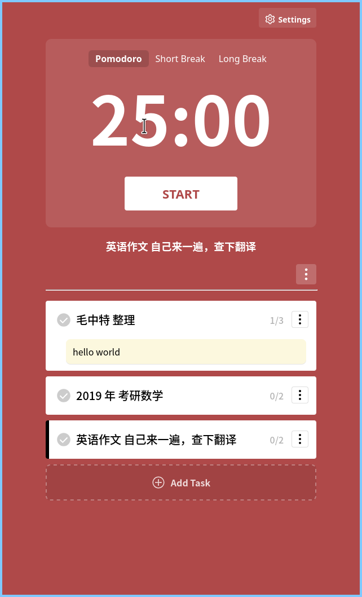
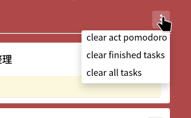

# Pomodoro --- 高仿的番茄钟应用

## 项目介绍

我这几年都在用这个[网站](https://pomofocus.io)进行番茄工作法，确实很好用\
但是最近扫黄打非比较严重，我这边的机场经常不稳定，导致时常连不上这个网站

我就想要不要仿照这个网站应用的样式自己写一个吧，于是我就在考研复习的时间中挤了一点把它做出来了(其实是6个月，慢吞吞的做出来了)

## 功能介绍



目前所有功能都做出来了，有

1. 添加任务
2. 添加任务的笔记，如图中的 "hello world"
3. 设置专注的番茄数量
4. 设置番茄的 工作时长，短休息时长和长休息时长，还有长时间休息的轮次
5. 对全体任务的操作，如清除已经专注的番茄数，删除已经完成的任务，删除所有任务

    

## 后续的功能开发

- [ ] 番茄数统计，按周，按月
- [ ] 用户可选计时提醒的音频
- [ ] 代码优化

## 技术细节

这个项目使用到的有

- Vue3(Typescript)
- Tauri2 技术，做桌面端
- pinia

有可能你会好奇，为什么要用 tauri，因为如果我只做网页的话，我还需要一个单独的http服务器来托管我的生成网页，老麻烦了，干脆用tauri来构建一个桌面应用

如果你需要在本地构建这个应用，请使用

```bash
yarn tauri build --bundles=deb,rpm
```

或者其他等效命令
